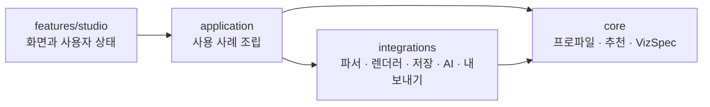

# VizPort Studio 아키텍처

## 한 문장 구조

화면은 사용자의 명령만 전달하고, `application`이 흐름을 조립하며, 순수한 `core`가 데이터 의미와 추천을 결정하고, 외부 라이브러리는 `integrations` 안에서만 감쌉니다.

의존 방향은 `features → application → core`가 기본입니다. `integrations`는 외부 라이브러리를 프로젝트의 자료형으로 번역하며 `core`를 참조할 수 있지만, `core`는 React, ECharts, AI SDK, Dexie를 알지 못합니다.

## 디렉터리 책임

### `src/core`

브라우저나 React 없이 테스트할 수 있는 제품 규칙입니다.

- `data-profile`: 입력 행에서 필드 종류와 통계를 계산합니다.
- `charts/definitions`: 차트 하나당 추천 조건, 점수, 기본 VizSpec 하나를 둡니다.
- `charts/catalog.ts`: 활성화할 차트를 명시적으로 등록하는 유일한 목록입니다.
- `recommendations`: 카탈로그 결과를 정렬하고 상위 후보를 고릅니다.
- `viz-spec`: 미리보기, 코드 생성, 프롬프트가 공유하는 이식 가능한 계약입니다.

### `src/application`

“입력을 읽고 추천을 만든다” 같은 사용자 작업을 조립합니다. 규칙이나 외부 라이브러리별 세부 코드를 두지 않습니다.

### `src/integrations`

교체 가능한 기술 경계입니다.

- `data-readers`: Papa Parse를 프로젝트의 `DataRow[]`로 변환합니다.
- `renderers`: VizSpec을 ECharts 옵션으로 변환합니다.
- `exporters`: VizSpec을 코드나 프롬프트로 변환합니다.
- `llm`: AI SDK/WebLLM을 동일한 추천 보정 결과로 변환합니다.
- `storage`: Dexie를 현재 프로젝트 저장 함수로 감쌉니다.

### `src/features/studio`

컴포넌트, 화면 전용 상태, 사용자 이벤트만 둡니다. 추천 점수나 차트 변환 로직을 여기에 넣지 않습니다.

## 변경할 때의 예상 경로

### 새 차트 하나 추가

1. `core/viz-spec/schema.ts`의 `chartTypeSchema`에 타입을 추가합니다.
2. `core/charts/definitions/<chart>.ts` 하나를 만들고 추천 조건과 기본 VizSpec을 작성합니다.
3. `core/charts/catalog.ts`에 등록합니다.
4. `integrations/renderers/echarts/toEChartsOption.ts`와 필요한 exporter에 변환을 추가합니다.
5. 해당 추천과 출력 테스트를 추가합니다.

화면 목록은 카탈로그 결과를 읽으므로 보통 UI 수정은 필요하지 않습니다.

### 새 LLM 공급자 추가

1. `LocalAiSettings`에 설정 타입을 추가합니다.
2. `integrations/llm` 안에 구조화 결과를 반환하는 어댑터를 추가합니다.
3. `refineRecommendations`의 공급자 선택 분기와 `AiRefinePanel`의 설정 폼만 확장합니다.

추천 후보를 만드는 핵심 규칙과 VizSpec은 바꾸지 않습니다. 모델이 실패해도 규칙 추천은 항상 남습니다.

### 새 미리보기 엔진 또는 WebGPU 렌더러 추가

1. `integrations/renderers/<engine>/`에서 VizSpec 변환기를 구현합니다.
2. 얇은 React 어댑터를 `features/studio/preview`에 추가합니다.
3. `renderer.preferred`에 따라 어댑터를 선택합니다.

프로파일링·추천·내보내기와 렌더러 구현을 섞지 않습니다.

## 의도적으로 하지 않은 것

- 차트별 클래스 계층, 범용 플러그인 프레임워크, 이벤트 버스는 현재 규모에서 이득보다 추적 비용이 커서 두지 않았습니다.
- LLM이 VizSpec 전체를 임의 생성하지 않습니다. 결정적 규칙이 후보를 만들고 LLM은 순서와 설명만 보정합니다.
- WebGPU를 모든 그래프에 강제하지 않습니다. 호환성 높은 Canvas 기본 경로를 유지하고 대규모 데이터나 브라우저 LLM에서 선택적으로 사용합니다.
- 서버 데이터베이스와 계정 시스템을 미리 만들지 않았습니다. 로컬 저장 요구는 IndexedDB 하나로 해결합니다.

## 유지보수 규칙

- `core`에 React 훅이나 외부 SDK를 import하지 않습니다.
- 외부 라이브러리의 자료형을 UI 전역에 퍼뜨리지 않고 integration 경계에서 VizSpec/DataRow로 바꿉니다.
- 같은 데이터 변환을 미리보기와 exporter에 복사해야 한다면 먼저 순수 유틸리티로 추출할지 검토합니다.
- 파일 하나가 추천, 렌더링, 저장 중 두 가지 이상을 책임지기 시작하면 책임별 파일로 나눕니다.
- 확장점은 실제 두 번째 구현이 생길 때 인터페이스로 추출합니다. 미래를 위한 추상화만 먼저 만들지 않습니다.
