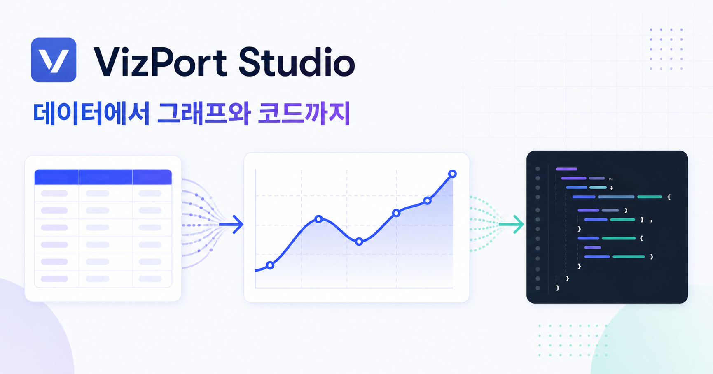
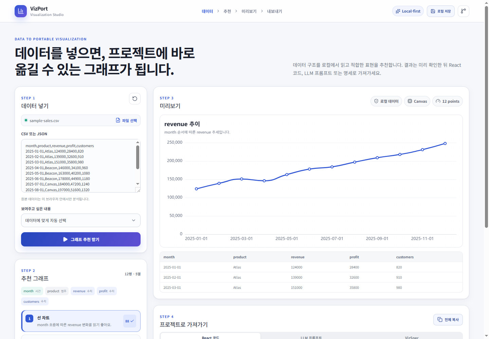
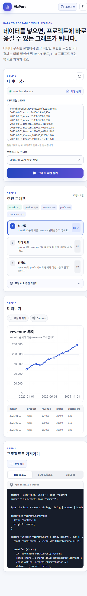
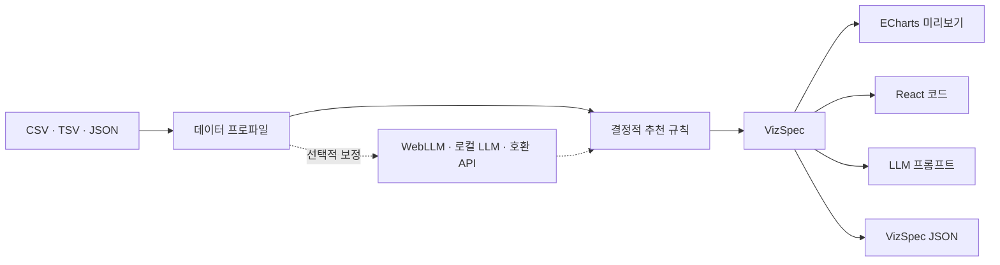

<div align="center">
  
  <h1>VizPort Studio</h1>
  <p><strong>데이터에서 추천 그래프, 실제 미리보기, 이식 가능한 코드까지.</strong></p>
  <p>
    CSV·JSON을 브라우저에서 분석하고 적합한 시각화를 추천한 뒤<br />
    React 코드, LLM 프롬프트, VizSpec으로 가져갈 수 있는 로컬 우선 시각화 스튜디오입니다.
  </p>
  <p>
    <a href="https://vizport-studio.okorion.chatgpt.site"><strong>라이브 데모</strong></a>
    ·
    <a href="./ARCHITECTURE.md">아키텍처 문서</a>
  </p>
  <p>
    
    
    
    
  </p>
</div>

<p align="center">
  
</p>

## 제품 한눈에 보기

<p align="center">
  
</p>

VizPort Studio는 하나의 화면에서 다음 네 단계를 연결합니다.

| 단계 | 사용자가 하는 일 | 결과 |
| --- | --- | --- |
| 1. 데이터 넣기 | CSV·TSV·JSON을 붙여 넣거나 파일로 선택 | 필드 종류, 결측치, 범주 수, 수치 범위를 브라우저에서 분석 |
| 2. 그래프 선택 | 목적에 맞는 추천 후보와 근거 확인 | 규칙 기반 점수와 주의사항이 포함된 차트 후보 |
| 3. 미리보기 | 실제 입력 데이터로 Canvas 차트 확인 | 그래프와 원본 데이터 테이블을 함께 검토 |
| 4. 가져가기 | 필요한 출력 형식을 선택해 복사 | React 코드, 구현용 LLM 프롬프트, VizSpec JSON |

<details>
  <summary><strong>모바일 전체 흐름 보기</strong></summary>
  <p align="center">
    
  </p>
</details>

## 왜 VizPort Studio인가요?

- **Local-first**: 원본 데이터와 프로젝트는 기본적으로 브라우저 밖으로 나가지 않습니다.
- **결정 가능한 추천**: LLM이 차트를 임의 생성하지 않고, 명시적인 규칙과 점수로 후보를 만듭니다.
- **AI는 선택 사항**: Ollama, LM Studio, WebLLM은 추천 순서와 설명만 보정합니다. AI가 없어도 전체 흐름이 동작합니다.
- **이식 가능한 결과**: 화면 캡처가 아니라 프로젝트에 넣을 수 있는 코드와 명세를 내보냅니다.
- **작은 변경 반경**: 차트, 렌더러, 내보내기, AI 공급자가 분리되어 수정 위치를 예측하기 쉽습니다.

## 주요 기능

### 데이터와 추천

- CSV, TSV, JSON 입력 및 파일 업로드
- 시간, 범주, 수치 필드 자동 감지
- 막대, 선, 영역, 산점도, 파이, 히스토그램 추천
- 비교, 추세, 분포, 관계, 구성비 목적별 점수 조정
- 추천 이유와 데이터 특성에 따른 주의사항 표시

### 미리보기와 내보내기

- Apache ECharts Canvas 기반 실제 데이터 미리보기
- React + TypeScript 컴포넌트 코드 생성
- 다른 LLM에 전달할 구현 프롬프트 생성
- 렌더러와 프로젝트 사이의 계약인 VizSpec JSON 출력
- IndexedDB 기반 로컬 프로젝트 저장

### 로컬 AI와 WebGPU

| 실행 방식 | 처리 위치 | API 키 | 비용 경계 |
| --- | --- | --- | --- |
| Ollama / LM Studio | 사용자의 로컬 모델 서버 | 보통 불필요 | 별도 모델 API 비용 없음 |
| 브라우저 WebLLM | 브라우저와 사용자 GPU | 불필요 | 모델 다운로드와 로컬 연산 사용 |
| OpenAI 호환 API | 사용자가 지정한 엔드포인트 | 공급자에 따라 필요 | 해당 공급자의 API 요금이 발생할 수 있음 |

WebLLM은 지원 브라우저에서 WebGPU를 사용합니다. 일반 차트 미리보기는 호환성이 높은 Canvas가 기본이며, `VizSpec.renderer.preferred`를 통해 대규모 데이터용 WebGPU 렌더러를 추가할 수 있도록 경계를 열어 두었습니다.

## 아키텍처



코드의 기본 의존 방향은 아래와 같습니다.

```text
features/studio  →  application  →  core
                         ↓
                   integrations
```

- `core`: 데이터 프로파일, 추천 규칙, 차트 정의, VizSpec처럼 순수하게 테스트할 수 있는 제품 규칙
- `application`: 입력 분석과 시각화 생성 같은 사용자 작업 조립
- `integrations`: Papa Parse, ECharts, Dexie, AI SDK, WebLLM을 감싸는 기술 경계
- `features/studio`: 화면, 사용자 이벤트, 화면 전용 상태

구조를 선택한 이유와 확장 순서는 [ARCHITECTURE.md](./ARCHITECTURE.md)에 자세히 정리되어 있습니다.

## 빠르게 시작하기

Node.js 22.13 이상이 필요합니다.

```bash
git clone https://github.com/okorion/vizport-studio.git
cd vizport-studio
npm install
npm run dev
```

브라우저에서 `http://localhost:3000`을 열면 샘플 데이터가 준비된 화면을 바로 확인할 수 있습니다.

### 검증 명령

```bash
npm run lint
npm run typecheck
npm test
```

## 가장 자주 수정할 위치

| 변경 목적 | 시작할 위치 | 함께 확인할 위치 |
| --- | --- | --- |
| 그래프 종류 추가·삭제 | `src/core/charts/definitions/` | `catalog.ts`, ECharts 변환기, exporter |
| 추천 점수·조건 변경 | 해당 `definitions/*.ts` | `recommendCharts.test.ts` |
| VizSpec 필드 변경 | `src/core/viz-spec/schema.ts` | renderer, exporter, 저장 데이터 |
| 입력 형식 추가 | `src/integrations/data-readers/` | `analyzeInput.ts` |
| 미리보기 엔진 교체 | `src/integrations/renderers/` | `ChartPreview.tsx` |
| 내보내기 형식 추가 | `src/integrations/exporters/` | `OutputPanel.tsx` |
| LLM 공급자 추가 | `src/integrations/llm/` | `AiRefinePanel.tsx` |
| 화면 구성 변경 | `src/features/studio/` | `app/globals.css` |

화면에 차트별 분기를 추가하기 전에 `core/charts/definitions`와 기존 integration에서 표현 가능한지 먼저 확인하는 것이 가장 중요한 유지보수 원칙입니다.

## 데이터와 보안 경계

- 입력한 원본 행은 브라우저에서 파싱되며, 프로젝트 저장을 선택한 경우에만 IndexedDB에 보관됩니다.
- AI 보정에는 원본 행 대신 필드 이름·종류·통계와 추천 후보 요약만 전달됩니다.
- API 키 입력값은 브라우저 메모리에만 있으며 저장소나 IndexedDB에 저장하지 않습니다.
- 외부 API를 선택하면 프로파일 요약이 사용자가 지정한 엔드포인트로 전송됩니다.
- 공개 또는 민감한 데이터에 적용하기 전에는 사용하는 API 공급자의 보관·과금 정책을 확인하세요.

## 현재 범위와 다음 확장점

- 현재 차트 미리보기는 ECharts Canvas를 사용합니다.
- WebGPU 차트 렌더러는 확장 경계만 정의되어 있으며 아직 기본 구현이 아닙니다.
- 서버 계정이나 중앙 데이터베이스 없이 로컬 프로젝트 저장을 우선합니다.
- 향후 차트 카탈로그, 프레임워크별 exporter, 대규모 데이터 렌더러를 독립적으로 확장할 수 있습니다.

## 라이선스

[MIT License](./LICENSE)로 공개합니다.
